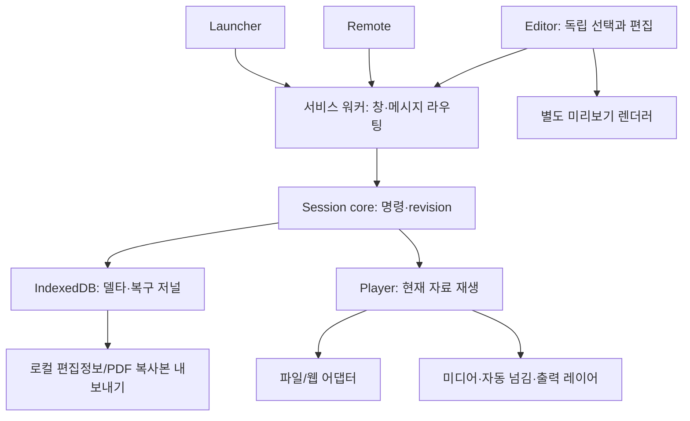

# 아키텍처와 책임

현재 실행되는 경로는 **Launcher → OPEN_WINDOW → service worker → Player/Remote/Editor 초기 창**이다. 아래 세션/렌더러/저장은 후속 구현 설계이며 타입 계약만 존재한다.

| 경계 | 책임 | 의존 금지/주의 |
|---|---|---|
| background | 창 생성·권한·라우팅, 재시작 후 저장 상태 조회 | 미디어 실행·장기 타이머·영구 상태 독점 |
| launcher | 최근 수업·새 수업·파일/링크 등록 입구 | action popup 수명에 발표를 묶지 않음 |
| player | 활성 자료 렌더링·재생·자동 넘김·공개 레이어 | 교사용 노트·Editor 선택 노출 |
| remote | 자료/페이지/재생/종료 명령, 개인 노트 | 재생 엔진 소유·리모컨 닫힘 시 Player 종료 |
| editor | 별도 렌더 컨텍스트, 편집 draft→commit | 탐색/미리보기로 발표 선택·미디어 변경 |
| core | 순수 상태 모델·명령 검증·revision·전환/종료 정책 | React/DOM/chrome 직접 호출 |
| adapters | PDF/PPTX/레거시/웹의 실제 기능과 역량 | 미검증 기능 지원 선언 |
| overlays | 정규화 좌표·색상·측정·undo/redo | 원본 직접 수정 |
| media | Player 시간 기준 타임라인·미디어 상태 | interval 횟수·창 focus를 시간 기준으로 사용 |
| storage | 델타·저널·참조·작은 설정·한도 캐시 | 대용량 원본 자동 복제·캐시를 정식 저장으로 표시 |
| export | 편집정보·복사본 생성, 완료/실패/취소 | 저장 성공 전 작업 상태 삭제 |

## 명령·영속화 계획

명령은 식별자와 기대 revision을 가진다. 변경 명령을 UI가 직접 다른 창의 React 상태에 쓰지 않는다. `core`에서 대상과 revision을 검사하고, 저장 계층이 원자적 commit 및 commandId 중복 처리 결과를 반환하면 승인된 snapshot/revision을 배포한다. 서비스 워커 재시작 때 저장 상태를 읽는다. 중복 명령의 ACK 재전송과 저널 보관 한도는 구현 시 결정한다.

Player의 연속 미디어 상태는 로컬 실행 컨텍스트가 소유하고 필요한 진행 지점을 체크포인트로 남긴다. 매 프레임 저장하지 않는다. Remote 재연결은 snapshot을 요청하며 Player에 새 재생 시작 명령을 암묵적으로 보내지 않는다.

## 디스플레이와 대안

현재 자동 배치 기능은 없다. `system.display` 실험 후 최소 권한과 환경별 차이를 기록한다. 실패 시 수동 드래그/모니터 지정 경로를 제공하고 연결 해제 때 보이는 화면으로 복구한다. 확장/복제 모드를 구분하고 단일/복제 화면에서는 교사용 노트 노출을 안내한다. OS 입력 장치의 완전 분리는 범위 밖이다.

빌드 설정은 [Vite의 다중 HTML 진입점](https://vite.dev/guide/build.html#multi-page-app)과 [MV3 module 서비스 워커](https://developer.chrome.com/docs/extensions/develop/concepts/service-workers/basics)를 참고했다. Chrome의 [독립 창 API](https://developer.chrome.com/docs/extensions/reference/api/windows)와 [웨일 공식 확장 API 안내](https://developers.whale.naver.com/api/extensions/)는 기술 근거이며 특정 웨일 버전의 동작 검증을 대신하지 않는다. 확인일: 2026-10-08.
