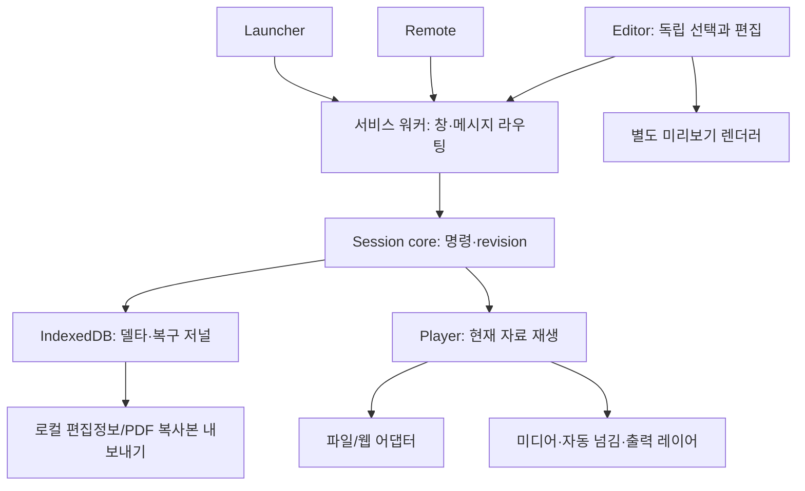

# 아키텍처와 책임

2026-10-14 `resourceInventory`는 sourceModel의 pending/ready 수명에만 붙은 숫자 집계 경계다. 식별자·원본·본문·File/Blob을 보관하지 않고 source 내부 raw backing과 owned Blob alias를 dedup한다. snapshot은 준비 시점 논리값이며 origin-wide registry나 physical/model heap 측정기가 아니다. [설계·근거](pptx/RESOURCE_INVENTORY.md).

2026-10-14 runtime.resolveMedia는binding/hash/geometry가확인된URL의stable borrowfactory를반환한다. LocalMediaPlayer acquire는동일identity/live/ownedBlob을확인하고source.retain lease를사용한다. settings/revision에서factory를새로만들지않아native재생을재시작하지않는다. parent dispose는borrower해제전ownedURL을폐기하지않는다. [증거](pptx/BORROWED_MEDIA_URL.md).

2026-10-14 sourceRead는취소가능한consumer와끝까지실행될수있는physical읽기를분리한다. SourceVault는get별controller·activeGets/close·broadcast정리를관리하고PPTXvalidator의signal은origin gate로전달한다. model/native예약을일찍해제하거나다른cache를evict하지않는다. [근거](pptx/SOURCE_CANCELLATION.md).

2026-10-14 preparationAdmission은등록/원본점검/source의새pending job·SourceVault identity읽기를origin-wide Web Locks로직렬화한다. 등록의내부behavior helper는재입장하지않고ready lease는gate를잡지않는다. activecallback의실제완료가reservation끝이며서비스워커재생/영구상태와독립이다. validator대기취소/ready모델byte예산은후속이다. [검증](pptx/PREPARATION_ADMISSION.md).

2026-10-14 shared/privateBuffer는검증/읽기가끝난private ArrayBuffer만선택형transfer(0)으로소비한다. PPTX adapter는다른part/view를확인한raw와Blob snapshot완료asset에만opt-in,media/input은immutableFile의해시scratch만finally정리한다. defaulthelper caller bytes·원본/공유source·nativeDOM은보존한다. 전역입장/전체WorkingSet기준은미해결. [근거](pptx/PRIVATE_BUFFERS.md).

2026-10-14 sourceModel의 guard→hydrate→embedded recovery 뒤 duplicateImageParts가 raster/작은 미디어 raw와 owned Blob을 스트림으로 대조한다. 성공만 근거/해제하고 source 마지막 owner dispose/error에서 private files를 비운다. 미디어 근거는 기존 largeMediaParts 조회에 합쳐 타이밍 바인딩을 유지한다. 전역 admission/WorkingSet 인수는 남는다. [증거](pptx/DUPLICATE_PARTS.md).

2026-10-14 sourceModel은동일File의ready/pending WeakMap과작업controller를사용한다. 개별signal은소비자를취소하고마지막waiter만작업abort,완료시live예약을readylease로이전한다. success pending은ready발행전제거해해제된publication의재사용을막는다. 전역작업/모델예산은아직없고비취소File읽기·raw/hydrated중복수명은후속이다. [증거](pptx/INFLIGHT_SOURCE.md).

2026-10-14 Editor의 usePptxDocumentSource가 선택 자료 하나의 lease/immutable File을 유지하고 쪽별OverlayEditor 안의 RegisteredPptxPreview에 전달한다. 기존 ready source WeakMap/최종owner 해제를 재사용, 늦은성공/취소와 이전ready 재사용을 막는다. 미디어 identity도 동일Blob/File의 성공값만 재사용하고 native metadata는 경계에서 다시 검사한다. PDF 초기화는 PPTX 모델을 로드하지 않는다. 전역/다중자료 예산은 남는다. [근거](pptx/SOURCE_REUSE_MEMORY.md).

2026-10-14 전환 입장은 SessionHub 직렬 큐의 저장된 형식 확인으로 제한한다. raw PPTX3종/자동 넘김을 거부하되 core COMMIT 원자 전환·PDF는 유지한다. 시험 helper도 정상 UI와 수동 metadata 계약으로 분리한다. 계획4 기능 검증은 통과했지만 대용량 WorkingSet 기준 초과로 자원 예산/해제 후 retained 메모리 분리가 남는다. [근거](pptx/TRANSITION_ADMISSION.md).

2026-10-14 Player staging: usePresentationStage는 지정 pending의 공개 목표/준비/최신 상태/확정을 조정하고 PlayerScene은 현재·숨긴 목표를 안정된 key로 유지한다. PptxView 쓰기·효과/native start와 LocalMediaPlayer checkpoint/재생은 활성 표면에만 허용한다. 준비 image/font/native data 대기는30초/취소를 적용한다. 승격은 같은 DOM/native 자산을 쓰고 효과 상태는 매 revision마다 ready로 덮어쓰지 않는다. Remote는 재파싱 없이 owner 조회/REQUEST/CANCEL한다. [근거·직접 입장 잔여](pptx/PREPARED_SCENE.md).

2026-10-14 Player전환1단계: core는발표선택과분리된pending/목표표식·요청/취소/확정/실패를처리하고store가receipt와원자저장한다. background는실제live context/소유권WebLock을durable응답까지유지한다. 목표조회는같은요청의public projection만반환하며노트/재생실행을제외한다. 준비consumer·현재표면유지/미디어전환·기존직접명령입장은아직연결하지않아현재Remote선행검사는유지한다. [계획](plans/2026-10-14-player-transition-commit.md).

2026-10-14 리모컨PPTX전환: `preparePresentationCommand`는목표를고정하고adapter의분리runtime검사후최신세션의대상·발표선택/지문/완료checkpoint를재검증한다. `transitionReadiness`는Player와동일runtime·source-v1복원을재사용하되쓰기/재생을금지하고표면은document에연결하지않는다. UI는취소/실패고지·다른자료의명시쪽원자활성화를제공한다. core는상태/검증만담당하며직접명령입장/Player표면staging은아직없다. [범위](plans/2026-10-14-pptx-transition-safety.md).

2026-10-14 PPTX 배경 계산 수정은 adapter용 고정 의존성 빌드 경계에 둔다. `pptxBackgroundPatch()`는client/worker에서정확한parser SHA/3지점만변환하고순수selector로bgRef스타일행렬을선택한다. 잘못된범위는특정오류를재전파하며다른fallback/guard는유지한다. 원본XML/파일·상태계약/권한은변경하지않는다. 라이브러리업데이트시변환은실패하고검토가필요하다. [근거](plans/2026-10-14-pptx-background-reference.md).

2026-10-14 글꼴 사전검사: 기존XML guard가슬라이드명시typeface를optional observer로전달하고PPTX adapter의localFonts가FontFace local조회/64종·1500ms대기/취소와숫자안내를담당한다. core/SW/Player렌더러와격리되어제품글꼴선택·document.fonts·권한·영속상태를바꾸지않는다. 명시참조외상속/테마/내장적용·glyph/라이선스/원본충실도는미확인이다. [계획/검증](plans/2026-10-14-pptx-local-font-preflight.md).

2026-10-14 sourceModel: hydrate 후 recoverEmbeddedMedia가 원본 p14내부관계/shape/header로 누락 media src를 보완하고 같은 자산 owner에 추가한다. 동일창·동일불변File 준비모델은 참조수명으로 공유하며 마지막dispose가Blob을해제한다. guarded입력은parser에transfer,큰media rawbuffer는size/hash근거캡처후해제한다. binder의원본/등록파일hash대조는유지한다. 첫동시준비job공유·여러창전체budget은미구현이다. [검증](pptx/TEACHER_02.md).

2026-10-13 대용량 미디어: ZIP metadata 검사·실제 Worker 수신·공식 모델 asset에 음원/영상64MiB 경계를 일치시켰다. 일반/XML/전체/ratio 검사는 유지한다. parser는 deferredIndex로 같은 자산 경로를 재사용하지만 Worker asset.slice/transfer와 원본 files·Blob 소유자는 여전히 메모리 비용을 가진다. 실제 teacher-02 표본 browser 합계 약1.45GiB, 원본 음원의 모델 src=null 문제는 별도다. [근거](pptx/TEACHER_02.md).

2026-10-13 runtime.refreshMediaTimeline은 기존 source/model/Blob/slots를 재사용해 현재 refs/설정의 후보 driver를 준비한다. 입력/회차·run/request·renderer를 재확인하고 현재 checkpoint 복원 뒤 교체한다. PptxView가 준비 상태를 표시하며 새 Player의 준비불가 source cursor는 실행 없는 구조복원 경로로 보존한다. [범위](pptx/MEDIA_TIMELINE_REFRESH.md).

2026-10-13 runtime source media 경로: sourceTimeline이 원본 그룹·전역조건·명시지연/설정·등록 출처를 함께 준비하고 sourceGroupDriver의 미디어-only cursor를 durablePlayback에 공급한다. PptxView registry의 endpoint를 deadline/run epoch·최신 ref 바인딩 확인 뒤 호출한다. 현재 Player 시작 시의 준비이며 발표 중 등록 후 재준비와 혼합 타이밍은 후속이다. [범위](pptx/SOURCE_TIMELINE_EXECUTION.md).

2026-10-13 PptxView는 실제 LocalMediaPlayer 요소마다 PptxNativeEndpoint를 등록/해제한다. endpoint는 native 실행·소유권·취소·durable 미디어 결과 ACK를 담당하고 LocalMediaPlayer는 자기 ACK 중복 적용을 억제한다. 원본 타이밍에서 이 등록 endpoint를 호출하는 runtime 통합은 후속이다. [범위](pptx/NATIVE_PLAYER_ENDPOINT.md).

2026-10-13 원본미디어 결과 저장: Player transport→background 소유권→strict CHECKPOINT_PPTX_MEDIA reducer/DB→공개bookmark. run/media epoch/현재설정/내장출처를 검사하며 sourceRunEpoch로 취소 소유범위를 보존한다. 원본 timing→native callback 연결과 자기ACK의불필요재적용방지는 후속이다. [계약](pptx/SOURCE_MEDIA_CHECKPOINT.md).

2026-10-13 sourceMediaSettings는 strict 원본/자산 binder 이후 명시적 vol/mute/p14trim을 읽고 native 길이로 기존 MediaPlayback을 만든다. Editor→connectMedia의 첫 등록 사전검사→기존 Player/Remote/백업 경로를 재사용하며 재연결은 사용자설정을 보존한다. 원본 timing 실행과 별개다. [근거/제한](pptx/SOURCE_MEDIA_SETTINGS.md).

2026-10-13 sourceMediaCalls는 strict 원본/자산 binder 다음에 cmd와 직접root 미디어 선언의 대응·정규화를 수행한다. runtime.resolveSourceMediaCalls는 요청 시 준비만 하며 현재회차의 timing 실행 권한을 부여하지 않는다. 원문문자열/미디어bytes를 session에 추가하지 않는다. [범위](pptx/NATIVE_MEDIA_ACTIONS.md).

2026-10-13 core/pptxMediaAction은 bounded 원본 call 어휘를 정규 객체로 변환한다. adapters/pptx/nativeMediaAction은 native 미디어와현재회차 callback으로 명령수락/취소를 검증한다. 서비스워커/원본문자열실행에 의존하지 않는다. 원본 cmd/root연관·시간조건과 Player durable bookmark의 통합은 미완료이며 제품 runtime에는 미연결이다. [범위](pptx/NATIVE_MEDIA_ACTIONS.md).

2026-10-13 `sourceShapeGroups.ts`는 공식 groupSteps와 원본 shapeSteps의 전체·순서 일치를 검사한다. runtime은 엔진 그룹수도 비교하고 Preflight/Player 상태에 결과를 전달한다. 실패 시 기존 transform 재생은 유지하되 원본그룹 실행은 허용하지 않는다. sourceGroupDriver로의 실행 연결은 원본 조건/native 미디어 검증 이후다. [계약](pptx/SOURCE_GROUP_PLAYBACK.md).

2026-10-13 `sourceOrder.ts`는 source mainSeq 구조그룹과 모델 효과 index를 대응하며 media-only/독립media 및 seq제어metadata를 보존한다. runtime이 현재쪽진단에 연결하고 Player는 효과상태와함께구조·미확인고지를 유지한다. 기존효과엔진을 원본미디어실행으로 확대하지 않으며 executionVerified=false다. [범위](pptx/SOURCE_ORDER.md).

2026-10-13 `mediaTimeNode.ts`는 원본 cTn의 부모/조건 참조·정규화 시간/반복 metadata를 읽는다. 기존 bounded XML 순회 안에서 호출하고 원본 숫자 요약은17개로 확장한다. 파싱과 원본 실행순서/Player 명령은 아직 분리돼 있다. [근거](pptx/MEDIA_TIMING.md).

2026-10-13 원본 timing target 대응은 `mediaTimingBinding.ts` 진단 API로 분리했다. 기존 등록 모델/안전 자산 추출을 재사용하고 원본 pic 관계와 ZIP 바이트 SHA-256을 추가 확인한다. DOM 문서 순서 metadata이며 실행 Player/runtime gate는 후속이다. [범위](pptx/MEDIA_TIMING.md).

2026-10-13 `packageGuard.inspectPptxXml`의 parsed Document를 `mediaTiming.ts`가 재사용해 bounded 숫자 요약을 반환한다. 파일 점검/모델 Preflight에 연결하며 원본 명령 실행이나 상태 저장은 하지 않는다. [근거](pptx/MEDIA_TIMING.md).

내장 영상의 양의 srcRect crop은 원본 viewport 내부의 native 영상 크기·위치로 적용한다. 안전한 shape clipPath는 SVG foreignObject의 userSpaceOnUse clip으로 공유하고 outline은 영상 위에 보존한다. 음수/과도crop·reflection은 제한으로 남긴다. 합성ellipse 실제픽셀 검증은 원본파일 충실도 인수와 구분한다.[근거](pptx/PLAYER_MEDIA.md).

2026-10-13 Player 내장미디어: runtime.resolveMedia가 이미 소유한 guarded 원본 모델/Blob을 정확히 재추출한다. source SVG data-el 내부 foreignObject에 기존 native Player를 portal로 넣고 repaint는 연결된 moveBefore로 노드를 보존한다. 같은 checkpoint의 다른 revision은 원본 repaint를 생략, slot은 수업/자료/쪽/runtime 범위로 격리한다. 별도 global 영상 fallback은 제공하지 않는다. 원본 trigger/고급 변형은 후속.[근거](pptx/PLAYER_MEDIA.md).

2026-10-13 Editor 내장 연결은 현재 비공개쪽을 명시적으로 검사·등록한다. nativemetadata 전부 확인 뒤 각 명령의 최신revision을 읽고 strict ACK 후 memory mediaVault 공급. 같은 출처는 기존 ID/설정/bookmark 유지. cancellation은 native probe와 Worker를 정리하며 ACK된 metadata는 보존하고 개수를 알린다. Player 원본 재추출/원본영상 합성은 후속이다.[근거](pptx/EMBEDDED_MEDIA.md).

2026-10-13 내장 미디어: guarded parser 소유자가 URL과 실제 Blob map을 함께 보관·해제한다. 추출은 fetch 없이 직접 조회하고 등록UUID/원본지문/manifest part/요소경로에 대응시킨다. 추출은 세션/vault에 쓰지 않으며 이후 UI·Player 연결 단계와 분리한다. [계약과 검증](pptx/EMBEDDED_MEDIA.md).

2026-10-13 PPTX overlay: 원본 SVG/runtime effect root와 별도 portal을 동일 비율 표면에 배치한다. Editor는 기존 OverlayEditor sourceView 주입으로 draft/확정·폰트측정을 재사용하고 Player는 공개 확정 overlays만 그린다. 좌표·폰트 측정 canvas는 원본 픽셀이 아니므로 sample capability를 unavailable로 표시하며 실제 원본색 추출은 별도 미완료다. [검증](pptx/OVERLAYS.md).

2026-10-13 일반Import: `prepareDocumentImport`는 명시적 실험 gate와 형식을 검사한 뒤 PDF/PPTX 준비·별도 원본vault로 lazy dispatch한다. Editor 등록ACK 후 안내, AbortSignal/수업ID로 늦은등록차단. 등록PPTX 비공개뷰는 등록UUID/원본part 바인딩·safeSVG/ShadowRoot/자산dispose를 재사용하고 발표엔진/소유권을 만들지 않는다. 기존노트는 strict델타/공개projection제외 유지. PDF OverlayEditor는PDF에만열고PPTX overlay통합은후속이다.[근거](pptx/PRODUCT_IMPORT.md).

2026-10-13 PPTX Remote UI: Remote는 strict 영속 요청/취소만 보낸다. 소유 Player view의 `PptxRequests`는 생성 당시 대기 요청을 보류하고 이후 새 요청을 한 번만 runtime.play(requestId)에 전달한다. 준비 중 새 요청은 준비 후 소비한다. 실행 취소는 native WAAPI 정리/마지막 완료 pose 복원, 완료 ACK 대기는 진행으로 유지한다. Remote의 일시적 안내는 별도 로컬 BroadcastChannel에 status/revision만 전달하며 실행 권한은 runtime/strict DB를 유지한다. [검증](pptx/REMOTE_REQUEST.md).

2026-10-12 단일 Player: PlayerAuthority가 trusted sender.documentId/getContexts + Web Locks + strict owner DB로 생존한 수업당 실행 창을 판정한다. Player 소유 hook은 grant 전 native 미디어/PDF/자동 넘김을 만들지 않는다. 중복 창은 검정 대기, owner없을 때만 승계. backend Player 실행 명령도 소유자를 재검증한다. worker 재생성은 owner DB를 재조회하며 장기 heartbeat/재생 타이머를 worker에 넣지 않는다. actualWhale worker stopped→running/WAV계속·중복거부·창닫힘승계 PASS(TEST_RESULTS04:26).

2026-10-12 미디어 조작: Remote의 SET_MEDIA_PLAYBACK/SEEK_MEDIA를 core가 현재 대상/구간/revision으로 검증하여 strict 저장한다. Player LocalMediaPlayer는 native volume/muted와 실제 currentTime 기반 구간 종료 deadline/timeupdate를 실행한다. epoch와 positionEpoch를 분리해 오래된 보고를 거부하면서 PAUSE는 마지막 native 위치를 보존한다. 정리 시 이미 확인된 ended 상태를 지우지 않는다. 서비스워커는 장기 재생/구간 타이머를 실행하지 않는다.

2026-10-12 재생 실행: Player의 useAutoplay가 공개 rule/checkpoint를 받아 PDF ready 이후 deadline 예약을 실행한다. LocalMediaPlayer는 별도 mediaVault에서 같은 SHA256의 로컬 원본을 얻어 native HTMLMediaElement로 재생한다. Remote는 설정/재개·정지, Player는 좁은 ADVANCE와 미디어 PLAY/CHECKPOINT 요청을 보낸다. core target·epoch·revision·경과 검증→strict DB commit→역할별 배포이며 서비스워커가 장기 타이머를 소유하지 않는다. 공개 metadata에 파일명/노트/Editor 정보는 없고 단일 실행 lease·편집pause·다른코덱/영상 인수는 후속이다.

제품 기준은 [PRD v5](../naver-ppt_PRD_v5.md)다. 현재 실행 경로는 **Launcher 수업 생성/선택 → service worker SessionHub → IndexedDB → 역할별 snapshot → Player/Remote/Editor**다. SessionHub는 요청마다 영속 상태를 읽고 commit 뒤 배포한다. Player에는 공개 selection/페이지/fingerprint/overlays만 전송한다. Remote 닫힘은 해당 구독만 제거한다. PDF 원본은 SourceVault가 관리하고 각 화면의 lazy PDF.js가 독립 렌더한다. 실제 Whale 확장 복구는 아직 미검증이다.

| 경계 | 책임 | 의존 금지/주의 |
|---|---|---|
| background | 창 생성·권한·라우팅, 재시작 후 저장 상태 조회 | 미디어 실행·장기 타이머·영구 상태 독점 |
| launcher | 최근 수업·새 수업·파일/링크 등록 입구 | action popup 수명에 발표를 묶지 않음 |
| player | 활성 자료 렌더링·재생·자동 넘김·공개 레이어 | 교사용 노트·Editor 선택 노출 |
| remote | 자료/페이지/재생/종료 명령, 개인 노트 | 재생 엔진 소유·리모컨 닫힘 시 Player 종료 |
| editor | 별도 렌더 컨텍스트, 편집 draft→commit | 탐색/미리보기로 발표 선택·미디어 변경 |
| core | 순수 상태 모델·명령 검증·revision·전환/종료 정책 | React/DOM/chrome 직접 호출 |
| adapters | PDF/PPTX/레거시/웹의 실제 기능과 역량 | 미검증 기능 지원 선언 |
| overlays | 정규화 좌표·색상·측정·undo/redo | 원본 직접 수정 |
| media | Player 시간 기준 타임라인·미디어 상태 | interval 횟수·창 focus를 시간 기준으로 사용 |
| storage | 델타·저널·참조·작은 설정·한도 캐시 | 대용량 원본 자동 복제·캐시를 정식 저장으로 표시 |
| export | 편집정보·복사본 생성, 완료/실패/취소 | 저장 성공 전 작업 상태 삭제 |

## 명령·영속화 계획

명령은 식별자와 기대 revision을 가진다. 변경 명령을 UI가 직접 다른 창의 React 상태에 쓰지 않는다. `core`에서 대상과 revision을 검사하고, 저장 계층이 원자적 commit 및 commandId 중복 처리 결과를 반환하면 승인된 snapshot/revision을 배포한다. 서비스 워커 재시작 때 저장 상태를 읽는다. 최근 256개 receipt로 중복 명령을 재적용하지 않는다. 클라이언트 port는 끊김 후 재연결하며 이전 snapshot을 보존하고 낮은 revision을 무시한다.

창 재사용은 일반 탭 URL 조회가 아닌 자체 확장의 `runtime.getContexts({documentUrls})`로 찾는다. 진행 중 생성 요청도 역할/수업별로 합친다. Player 재사용은 focus를 회수하지 않는다. 이 API가 없거나 조회 실패하면 중복 생성 대신 오류를 반환한다. [공식 API 근거](https://developer.chrome.com/docs/extensions/reference/api/runtime#method-getContexts)는 Whale 구현 확인을 대신하지 않는다.

Player의 연속 미디어 상태는 로컬 실행 컨텍스트가 소유하고 필요한 진행 지점을 체크포인트로 남긴다. 매 프레임 저장하지 않는다. Remote 재연결은 snapshot을 요청하며 Player에 새 재생 시작 명령을 암묵적으로 보내지 않는다.

## PDF 원본과 렌더

현재 PDF 경로: Editor 공통 Import에서 128MB/헤더/SHA-256 → 중복·재연결 → lazy PDF.js 페이지 분석(최대 2000) → 원본 참조 → 등록. 파일 핸들은 별도 IDB, fallback File은 실행 메모리만 보유한다. 자체 오리진 BroadcastChannel로 원본을 요청하며 SW에 바이너리를 보내지 않는다. PdfView는 세션 fingerprint와 원본 참조의 일치를 확인한다.

화면마다 PdfRenderer와 캔버스는 독립이다. 현재 및 앞뒤 선행 렌더, 직렬 큐/AbortSignal/cleanup/destroy, 캔버스 3개/64MB LRU/800만 픽셀/DPR 최대 2를 적용한다. 이는 전체 PDF 파서/프로세스 메모리 상한이 아니다. 자체 worker/CMap/표준 폰트/WASM/ICC를 패키징하고 XFA/QuickJS sandbox/PDF 스크립트·링크 자동 실행은 제공하지 않는다. 주석/임베디드 미디어/특수 PDF 충실도는 후속 실험이다.

## 디스플레이와 대안

현재 자동 배치 기능은 없다. `system.display` 실험 후 최소 권한과 환경별 차이를 기록한다. 실패 시 수동 드래그/모니터 지정 경로를 제공하고 연결 해제 때 보이는 화면으로 복구한다. 확장/복제 모드를 구분하고 단일/복제 화면에서는 교사용 노트 노출을 안내한다. OS 입력 장치의 완전 분리는 범위 밖이다.

빌드 설정은 [Vite의 다중 HTML 진입점](https://vite.dev/guide/build.html#multi-page-app)과 [MV3 module 서비스 워커](https://developer.chrome.com/docs/extensions/develop/concepts/service-workers/basics)를 참고했다. Chrome의 [독립 창 API](https://developer.chrome.com/docs/extensions/reference/api/windows)와 [웨일 공식 확장 API 안내](https://developers.whale.naver.com/api/extensions/)는 기술 근거이며 특정 웨일 버전의 동작 검증을 대신하지 않는다. 확인일: 2026-10-08.
